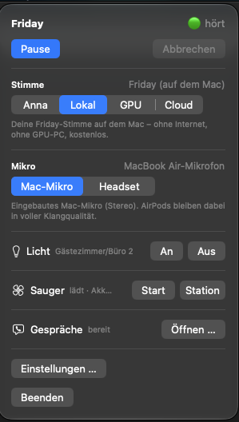
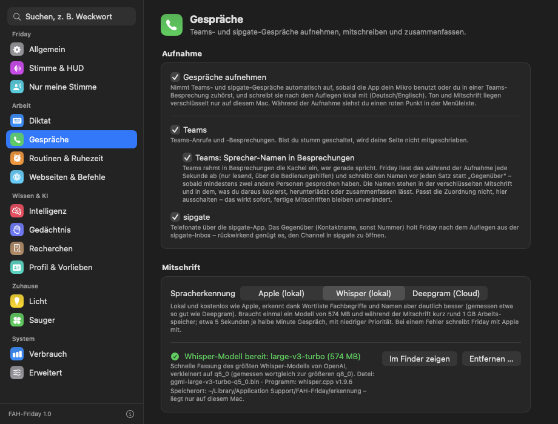
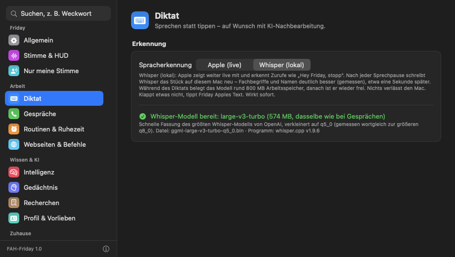

# FAH-Friday – Sprachassistentin für den Mac

Friday hört auf „Hey Friday“, versteht Deutsch, spricht zurück und steuert deinen Mac: Apps öffnen, Termine vorlesen,
diktieren, WiZ-Lampen schalten, den Roborock-Sauger losschicken – und für alles Knifflige denkt sie mit Claude mit.
Spracherkennung und Steuerung laufen lokal auf dem Mac – auf Wunsch mit Whisper, ganz ohne Cloud.

## ⬇️ Download

**[FAH-Friday herunterladen (ZIP, ca. 40 MB)](https://github.com/Arachnolord/fah-friday/releases/latest/download/FAH-Friday-ohne-Sprachmodell.zip)**

Alle Versionen: [Releases](https://github.com/Arachnolord/fah-friday/releases) · für Macs mit Apple-Chip (M1 und neuer)

## So sieht sie aus

**Das HUD** schwebt über allem und zeigt, was Friday gerade tut – wie eine KI, die mitdenkt: In Ruhe zuckt ab und zu ein
Gedanke durch ihr Netz, beim Zuhören öffnet sich die Blende um den Kern und schlägt im Takt deiner Stimme aus, beim
Denken feuern Signalketten in immer neuen Mustern, beim Arbeiten schießen sie nach außen. Drei Themen zur Wahl
(dazu HAL), am Orb frei verschiebbar:

| Menü in der Menüleiste | Einstellungen – Seitenleiste, Suche, lokales Whisper |
|---|---|
|  |  |

Diktat mit lokalem Whisper – Friday tippt, was du sagst, Fachbegriffe und Namen inklusive:

## Erster Start

1. ZIP entpacken.
2. Rechtsklick auf **Entsperren.command** → „Öffnen“ → im Dialog „Öffnen“.
   Das entsperrt die App einmalig und startet sie (die App ist nicht von Apple notarisiert).
3. Mikrofon- und Spracherkennungs-Zugriff erlauben. Oben in der Menüleiste erscheint das Friday-Symbol.

Ausführlich steht alles in der **LIESMICH.txt** im ZIP.

## So benutzt du sie

- **„Hey Friday …“** oder **„Friday …“** vor jedem Befehl – z. B. „Hey Friday, öffne Safari“, „Friday, wie ist mein Tag heute“.
- **Diktat:** „Hey Friday, Diktat“ → alles Gesagte wird ins aktive Textfeld getippt, bis „Hey Friday, stopp“.
  Wahlweise mit **Whisper (lokal)**: Friday schreibt jedes Stück auf dem Mac neu und erkennt Fachbegriffe deutlich besser.
  Das Modell (large-v3-turbo, 574 MB) lädt Friday beim ersten Auswählen selbst und prüft es per Prüfsumme.
- **Licht (WiZ):** „Hey Friday, Licht im Wohnzimmer an“, „Licht auf 30 Prozent“ – direkt im Heimnetz, ohne Cloud.
- **Sauger (Roborock):** „Hey Friday, saug die Küche“, „Sauger zur Station“ – nach einmaliger Anmeldung nur im Heimnetz.
- Name, Vorlieben, Stimme, HUD-Thema, Licht und Sauger stellst du im Friday-Menü unter **Einstellungen** ein –
  mit Seitenleiste und Suche („Weckwort“, „Whisper“, „HUD“ …).

## Stimme

Diese Ausgabe enthält **keine trainierte Friday-Stimme**. Friday spricht mit der besten installierten deutschen
macOS-Stimme (am schönsten mit einer „Premium“-Stimme) – optional über **ElevenLabs** mit deinem eigenen API-Schlüssel
(liegt nur im macOS-Schlüsselbund). Eine eigene lokale Piper-Stimme lässt sich in den Einstellungen einrichten.

## Voraussetzungen

- macOS auf einem Mac mit Apple-Chip.
- Für die mitdenkenden Antworten („Gehirn“) muss **[Claude Code](https://claude.ai/code)** installiert und angemeldet sein.
  Ohne das funktionieren Sprachsteuerung und direkte Befehle weiterhin.

## Gut zu wissen

- Friday führt Befehle **selbst auf deinem Mac aus**. Unumkehrbares (senden, kaufen, löschen, posten) macht sie nur nach
  Rückfrage – nur ein klares „Ja“ führt aus; „Nein“, „Stopp“ oder Schweigen bricht ab.
- Persönliche Einstellungen bleiben auf deinem Mac (`~/Library/Application Support/FAH-Friday/`); Schlüssel liegen im
  macOS-Schlüsselbund.

## Fremdbestandteile

Sprechererkennung: [sherpa-onnx](https://github.com/k2-fsa/sherpa-onnx) (Apache-2.0), ONNX Runtime (MIT),
Modell [3D-Speaker ERes2Net](https://github.com/modelscope/3D-Speaker) (Apache-2.0). Lizenzangaben in der App unter
`Contents/Resources/stimme/LIZENZEN.txt`.
Spracherkennung lokal (optional): [whisper.cpp](https://github.com/ggml-org/whisper.cpp) v1.9.6 (MIT, Lizenz unter
`Contents/Resources/erkennung/LIZENZ-whisper.cpp.txt`), Modell OpenAI Whisper large-v3-turbo (MIT) – wird nicht
mitgeliefert, sondern bei Bedarf geladen.

---

© 2026 Fabian Hammer – Alle Rechte vorbehalten. Inoffiziell; nicht verbunden mit Apple, Anthropic, ElevenLabs, WiZ oder Roborock.
